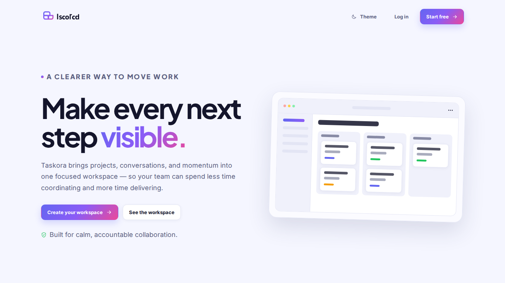
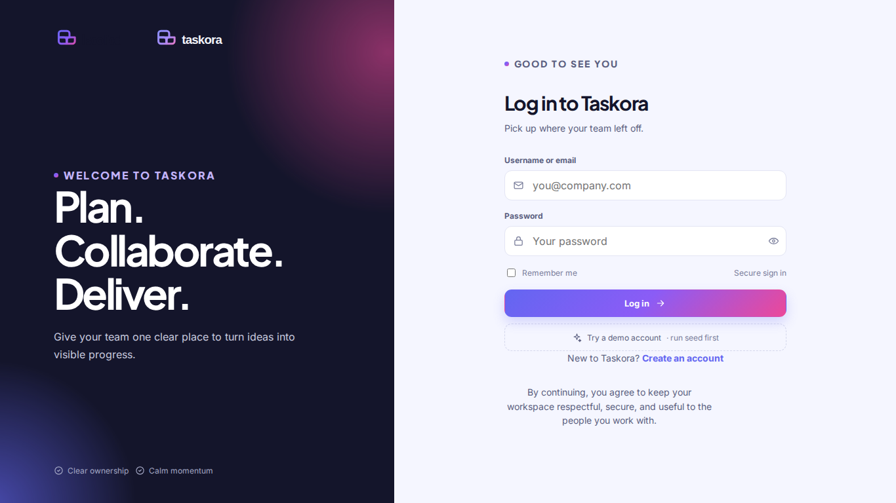
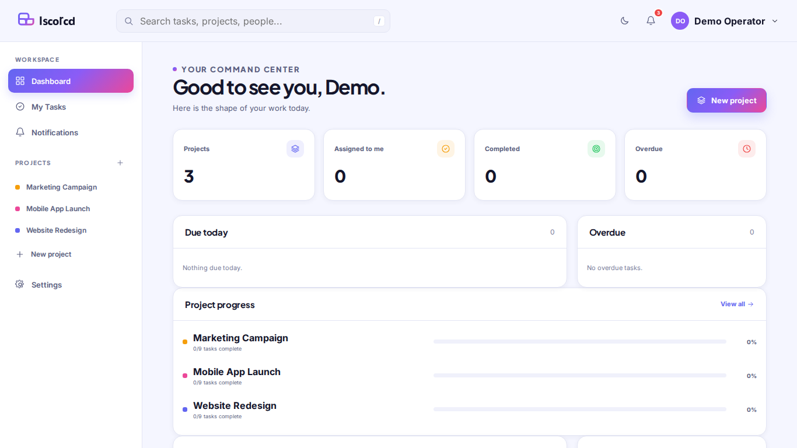
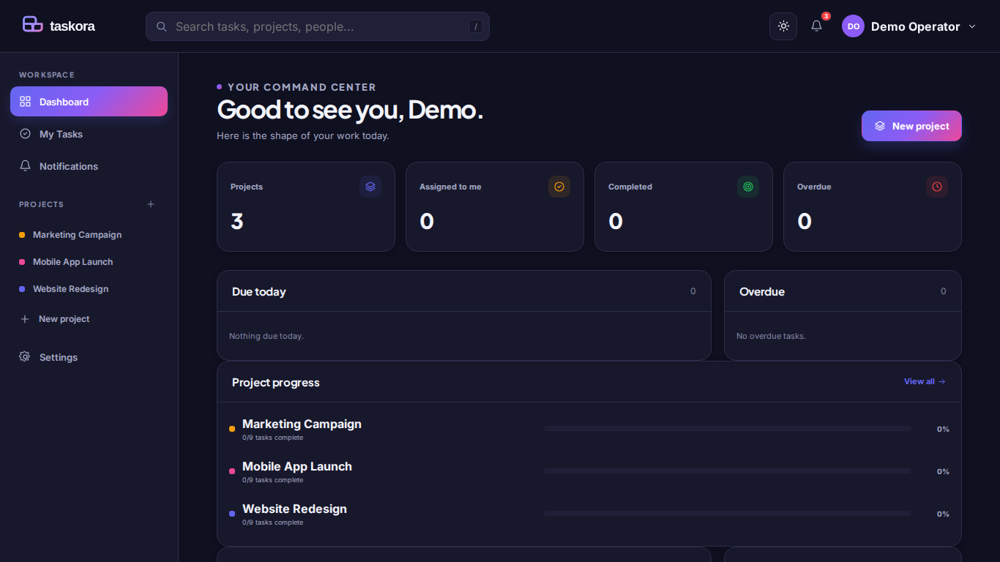
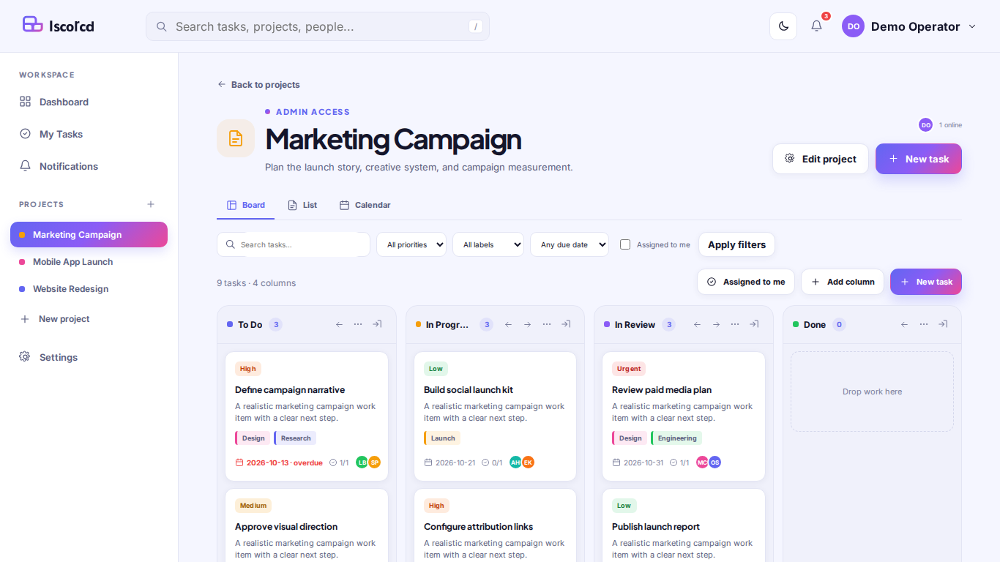
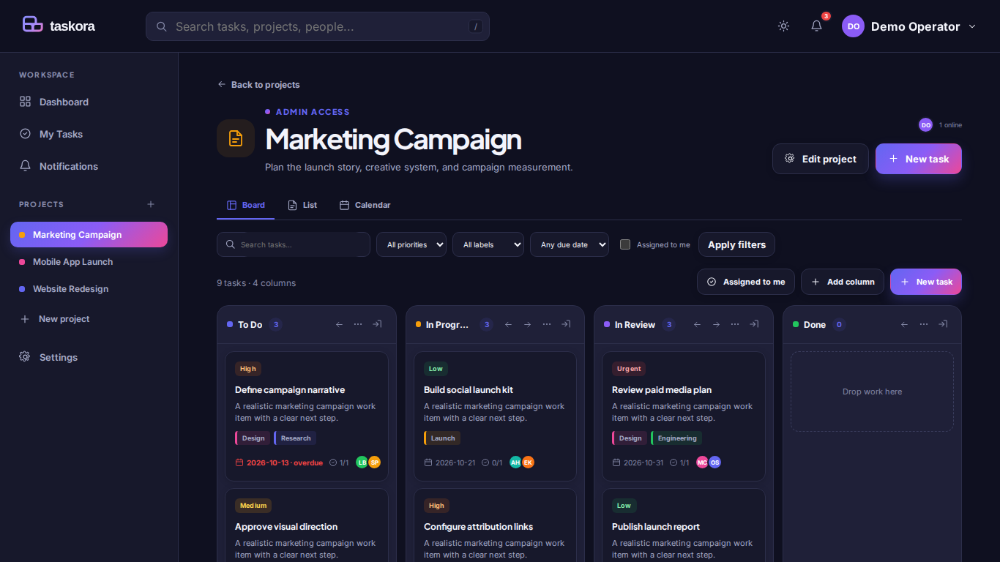
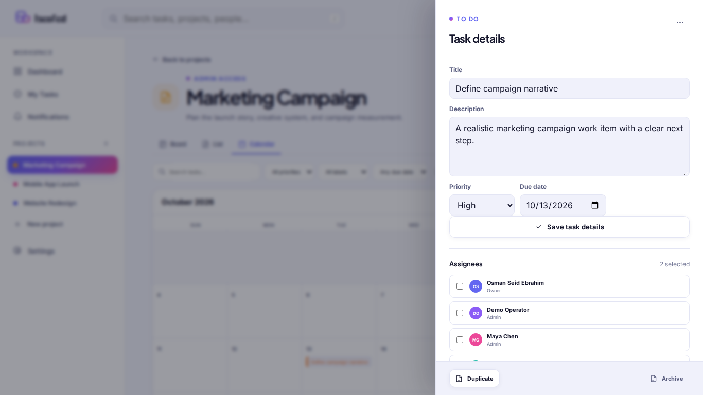
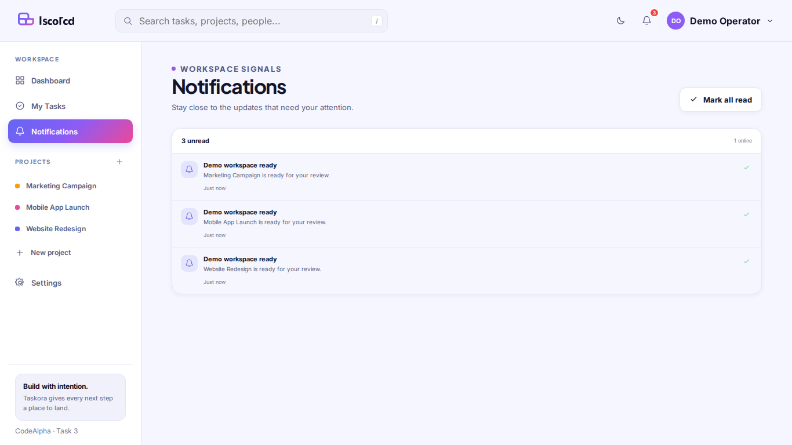
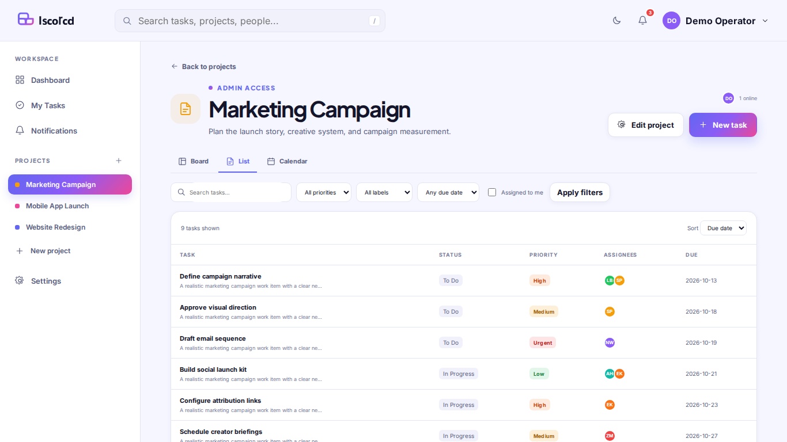
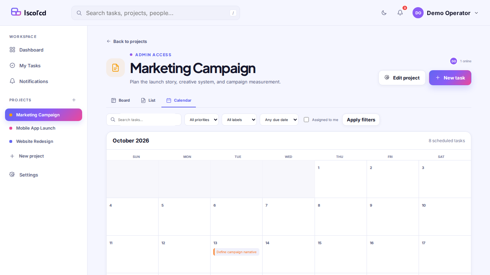

# Taskora — Project Management Tool

<div align="center">
  
  <p><strong>Plan. Collaborate. Deliver.</strong></p>
  <p>A focused full-stack project management workspace built for CodeAlpha Full Stack Internship — Task 3.</p>
</div>

Taskora is a web‑based project management application designed to help individuals and teams organize projects, manage tasks, collaborate efficiently, and track progress in one place. It provides a centralized workspace with project boards, task assignments, comments, notifications, and real‑time updates.

## 🚀 Features

- **Dashboard:** View project and task statistics, including upcoming and overdue tasks.
- **Project Management:** Create and organize projects and collaborate with team members.
- **Task Management:** Create, assign, prioritize, and update tasks.
- **Kanban Board:** Organize tasks into columns and move them using drag‑and‑drop (mobile‑friendly controls).
- **Task Details:** Manage task information, checklists, assignments, and comments.
- **Team Collaboration:** Invite members and communicate through task comments and @mentions.
- **Real‑Time Updates:** Keep project information synchronized across connected users via Socket.io.
- **Notifications:** Receive notifications about assignments, mentions, moves, due‑soon alerts, and invitations; unread badge, dropdown, and center page with mark‑as‑read.
- **Multiple Views:** Board, List, and Calendar views with search and filters.
- **Theme Support:** Light and dark themes with persisted user preference.
- **Authentication:** Secure accounts with JWT stored in an httpOnly cookie.

## 🛠️ Technology Stack

- **Frontend:** HTML, CSS (light/dark design tokens), vanilla JavaScript.
- **Backend:** Node.js, Express.js, REST API.
- **Database:** SQLite with **better‑sqlite3** (pre‑built binaries for Node 20‑24, WAL mode, foreign‑key enforcement).
- **Real‑Time:** Socket.io for board updates, presence, typing indicators, and notification toasts.
- **Authentication:** JSON Web Tokens (httpOnly, SameSite/Lax, Secure on hosted).
- **Configuration:** dotenv.

## 📋 Requirements

- **Node.js** >= 20 (LTS 22 recommended; works on Node 24). 
- **npm** (included with Node).

## ⚙️ Installation and Setup

```bash
git clone https://github.com/generalareas9-sys/CodeAlpha_ProjectManagementTool.git
cd CodeAlpha_ProjectManagementTool
npm install                # installs dependencies (better‑sqlite3 pre‑built)
cp .env.example .env       # copy template and set JWT_SECRET and other vars
npm run seed               # create demo accounts and projects
npm start                  # http://localhost:5000
6. Open the application in your browser:

   http://localhost:5000/

**Note:** The local URL works only on the computer running the application.
```

> **Windows PowerShell:** use `Copy-Item .env.example .env` instead of `cp`.

## 🧪 Testing

```bash
npm test   # runs the full integration test suite (8 passing tests)
```

The suite covers SQLite foreign‑keys, password helpers, auth flow, project/role permissions, column/task ordering, collaboration features, notifications, and real‑time socket events.

## 🔐 Security Notes

- Keep `.env` private; never commit it.
- Use a strong, unique `JWT_SECRET`.
- All SQL statements are parameterized; foreign‑keys and WAL mode are enabled.
- Helmet, express‑rate‑limit, and strict cookie flags are applied.
- XSS‑safe rendering: user‑generated content is escaped on the server and client.

## 📁 Project Structure

```
CodeAlpha_ProjectManagementTool/
├── public/                 # Frontend assets (HTML, CSS, JS, icons)
├── src/                    # Backend source
│   ├── db/                 # SQLite connection & schema
│   ├── lib/                # auth, notifications, realtime helpers
│   ├── middleware/         # auth, role checks, validation
│   └── routes/             # API endpoints
├── scripts/                # seed data, screenshot capture
├── screenshots/            # generated visual QA screenshots
├── data/                   # SQLite .db files (ignored by git)
├── server.js               # Express + Socket.io entry point
├── package.json
├── .env.example
├── .gitignore
└── README.md
```

## 📸 Screenshots (generated with `npm run screenshots`)

| Landing | Login |
|---|---|
|  |  |
| Dashboard (light) | Dashboard (dark) |
|  |  |
| Board (light) | Board (dark) |
|  |  |
| Task detail | Notifications |
|  |  |
| List view | Calendar view |
|  |  |

*Screenshots are 1366×768; if Playwright cannot run, install Chromium manually with `npx playwright install chromium` and capture them by opening the app in a browser and using the OS screenshot tool.*

## 🔧 Getting Started Scripts

```bash
npm start           # start server on port 5000
npm run dev         # start with file watch (node --watch)
npm run seed        # (re)seed demo data (idempotent)
npm run screenshots # capture all screenshots (requires server running)
```

## 👥 Demo Accounts

All seeded accounts share the password `Password123!`.

- `demo` – Demo Operator (convenience account)
- `osman` – Osman Seid Ebrahim
- `maya` – Maya Chen
- `liam` – Liam Brooks
- `sofia` – Sofia Patel
- `noah` – Noah Williams
- `amira` – Amira Hassan
- `ethan` – Ethan Kim
- `zoe` – Zoe Martin

The seed creates three projects (Website Redesign, Mobile App Launch, Marketing Campaign) with 27 tasks, labels, assignees, due dates (including overdue), checklists, comments, activity logs, and notifications.

## 📚 REST API Reference

All protected routes require the `webdev_app_session` cookie.

| Area | Endpoints |
|---|---|
| Auth | `POST /api/auth/register`, `POST /api/auth/login`, `POST /api/auth/logout`, `GET /api/auth/me` |
| Users | `GET /api/users?search=`, `GET /api/users/me`, `PUT /api/users/me`, `PUT /api/users/me/password` |
| Dashboard | `GET /api/dashboard` |
| Projects | `GET/POST /api/projects`, `GET/PUT/DELETE /api/projects/:id` |
| Members | `POST /api/projects/:id/members`, `PUT/DELETE /api/projects/:id/members/:userId`, `POST /api/projects/:id/members/me` |
| Columns | `POST /api/projects/:id/columns`, `PUT/DELETE /api/columns/:id`, `PUT /api/projects/:id/columns/reorder` |
| Tasks | `GET/POST /api/projects/:id/tasks`, `GET/PUT/DELETE /api/tasks/:id`, `PUT /api/tasks/:id/move`, `POST /api/tasks/:id/archive`, `POST /api/tasks/:id/duplicate` |
| Task details | `GET /api/tasks/:id/detail` plus sub‑routes for assignees, labels, checklist, comments, activity |
| Notifications | `GET /api/notifications`, `POST /api/notifications/:id/read`, `POST /api/notifications/read-all` |

Task list endpoints support `search`, `assigneeId=me`, `priority`, `labelId`, and `due=today|week|overdue` query parameters.

## 🔁 Real‑time Socket.io Events

| Direction | Event | Payload |
|---|---|---|
| Client → Server | `project:join` | `{ projectId }` |
| Client → Server | `project:leave` | `{ projectId }` |
| Client → Server | `typing:start` / `typing:stop` | `{ projectId, taskId? }` |
| Server → Client | `task:created` | `{ task }` |
| Server → Client | `task:updated` | `{ task }` |
| Server → Client | `task:moved` | `{ task, fromColumnId, toColumnId, position }` |
| Server → Client | `task:deleted` | `{ taskId }` |
| Server → Client | `comment:added` | `{ comment }` |
| Server → Client | `member:joined` | `{ user, projectId }` |
| Server → Client | `presence:update` | `{ projectId, online, users }` |
| Server → Client | `typing:start` / `typing:stop` | `{ projectId, taskId?, user }` |
| Server → Client | `notification:new` | `{ notification }` |

## 📊 CodeAlpha Task 3 Requirements

| Requirement | Implementation |
|---|---|
| Auth system (register, login, logout, me; unique username/email; hashed passwords; httpOnly JWT cookie; protected routes) | `src/lib/auth.js`, `routes/auth.js`, middleware, tests ✔ |
| Group projects (create, edit, archive, delete; invite members by username/email; roles Owner/Admin/Member/Viewer; leave/remove members) | `routes/projects.js`, role checks, invitation logic ✔ |
| Project boards (columns To Do / In Progress / In Review / Done; CRUD, reorder, drag‑and‑drop; positions persisted) | Columns API, task `move` endpoint, DB schema, tests ✔ |
| Task cards (title, description, priority, due date, overdue styling, labels, checklist, assignee avatars, comment count, drawer, duplicate, archive, delete) | Tasks API, detail endpoint, UI components, tests ✔ |
| Assign tasks (multiple assignees, "Assigned to me" filter, My Tasks page) | `/api/tasks/:id/assignees`, `assigneeId=me` filter, UI page ✔ |
| Comments & communication (add/edit/delete own comment, @mentions, timestamps, activity log) | Comments API, activity aggregation, tests ✔ |
| Backend (REST API, SQLite, foreign keys, WAL) | `src/db/schema.sql`, connection, tests ✔ |
| Bonus – notifications & real‑time (assigned, mentioned, commented, moved, due‑soon, invited) with unread badge, dropdown, page, mark‑as‑read; live board, live comments, presence, typing indicator, toasts | Notification model, socket events, UI badge, tests ✔ |

## 📦 Production Readiness

- `npm start` listens on `process.env.PORT` (defaults to 5000) and trusts proxy for hosted environments.
- Health check: `GET /healthz` returns `{ ok:true, service:"taskora" }`.
- Auto‑seed runs on first start if `data/*.db` is missing.
- `data/` directory is created automatically if absent.
- `.gitignore` excludes `node_modules/`, `.env`, `*.db*`, `uploads/`, `.DS_Store`, `data/`.

## 📖 License

MIT – see [LICENSE](LICENSE).

---

## Run Locally

1. Clone this repository.
2. Install dependencies:

   ```bash
   npm install
   ```

3. Configure your `.env` file with the required environment variables.
4. Seed demo data if needed:

   ```bash
   npm run seed
   ```

5. Start the application:

   ```bash
   npm start
   ```

6. Open the application in your browser:

   http://localhost:5000/

**Note:** The local URL works only on the computer running the application.


*Built by **Osman Seid Ebrahim** for the CodeAlpha Full‑Stack Internship, Task 3.*
